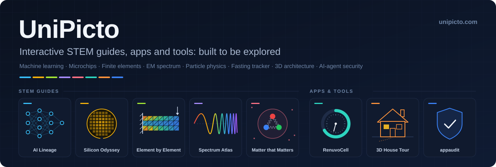

<p align="center">
  <a href="https://unipicto.com">
    
  </a>
</p>

<p align="center">
  <b>Free, interactive guides that explain how technology works, in your browser.</b><br>
  Scroll, drag and change the values: the figures are calculated live, not played back as video.<br>
  You can read each guide at a beginner, practitioner or specialist level.
</p>

<p align="center">
  <a href="https://ai-lineage.unipicto.com/"></a>
  <a href="https://silicon-odyssey.unipicto.com/"></a>
  <a href="https://fem.unipicto.com/"></a>
  <a href="https://spectrum-atlas.unipicto.com/"></a>
  <a href="https://github.com/marketplace/actions/appaudit-ai-agent-add-on-scan"></a>
</p>

---

## 🧭 Interactive guides

<table>
<tr>
<td width="50%" valign="top">

### 🧠 [AI Lineage](https://ai-lineage.unipicto.com/)
**Machine-learning and LLM playground**

A field guide you scroll through, from AI built on hand-written rules to systems that write their own rules.

- **16 chapters:** classical ML, data, neural networks, CNNs and attention, LLM decoding, diffusion, agents, AI chips, responsible AI, failure modes and quantum computing
- Demos run live in the browser, with no pretrained model weights to download
- Atlas that compares **19 algorithms**
- Three reading levels: Explorer, Practitioner and Researcher. Works offline after your first visit

**[→ Open AI Lineage](https://ai-lineage.unipicto.com/)**

</td>
<td width="50%" valign="top">

### 🔬 [Silicon Odyssey](https://silicon-odyssey.unipicto.com/)
**How microchips are made**

Zoom from a 300 mm silicon wafer down to the atoms of one transistor, in a single continuous 3D view.

- **10 kinds of chip** and **10 transistor structures**
- What "3 nm" actually means, and how a metal layer is built
- Guided journeys: from wafer to package, from electric charge to a picture, from a line of code to the processor core
- Simple, Detailed and Scientific modes. In English and Dutch

**[→ Open Silicon Odyssey](https://silicon-odyssey.unipicto.com/)**

</td>
</tr>
<tr>
<td width="50%" valign="top">

### 🏗️ [Element by Element](https://fem.unipicto.com/)
**Finite element method (FEM) lab**

See the finite element method at work, one step at a time.

- Mesh a beam, a plate with a hole, a bracket or a hot pipe
- Build the stiffness matrix one element at a time, apply the boundary conditions, solve and read the stresses
- Every number is calculated live in your browser
- Simple, Detailed and Scientific modes. In English and Dutch

**[→ Open Element by Element](https://fem.unipicto.com/)**

</td>
<td width="50%" valign="top">

### 🌈 [Spectrum Atlas](https://spectrum-atlas.unipicto.com/)
**The electromagnetic spectrum, from radio waves to gamma rays**

The whole spectrum as one wave that you can scroll, tap and play with.

- Set a wavelength, frequency or photon energy on a log scale, and the other two update
- Labs for emission lines, optics, wave behaviour and black-body radiation
- *Hear* light: wavelengths turned into audible tones
- Atmosphere, radiation dose scale, uses in industry, and a quiz on common misconceptions
- Six-stop tour for young explorers, plus a Technical view

**[→ Open Spectrum Atlas](https://spectrum-atlas.unipicto.com/)**

</td>
</tr>
</table>

---

## 🛡️ Open source: [appaudit](https://github.com/unipicto/appaudit)

[](https://github.com/unipicto/appaudit/releases)
[](https://github.com/unipicto/appaudit/blob/main/LICENSE)
[](https://github.com/marketplace/actions/appaudit-ai-agent-add-on-scan)

**Non-destructive security assessments with Claude**, for systems you own or have the owner's written permission to test: web apps, APIs, supply chains, mobile and IoT apps, firmware, AI agents, and the plugins, skills and MCP servers you add to your AI tools.

- **Checks add-ons before you install them:** an offline scanner with 64 rules that never runs the code, an independent reviewer and a verifier, then an install decision
- **Scope guard and evidence log:** no live test until permission is recorded, and every action that reaches the network is logged in a hash chain
- **Current standards:** OWASP Top 10:2025, ASVS 5.0, LLM Top 10 2026, MASVS 2.1, ETSI EN 303 645, CVSS v4.0, SSVC, EPSS and KEV
- **Six audit-ready outputs every run:** brief, report, findings.json, SARIF, findings register and evidence bundle. Regulatory flags for 9 jurisdictions

Add it to your CI with the GitHub Action:

```yaml
- uses: unipicto/appaudit@v4        # pin to a commit SHA in production
  with:
    path: .                         # a plugin, a skill folder or a whole repository
    fail-on: High
```

Runs in Claude Code, Cowork and claude.ai, and can also be used with Codex, Gemini CLI, Copilot and Cursor. → [Install guide](https://github.com/unipicto/appaudit#install)

---

## ✳️ How we build

| | |
|---|---|
| **Interactive, not video** | You change the inputs and the result is calculated again in front of you |
| **One page, several depths** | Each guide has reading levels from curious beginner to specialist |
| **Nothing to install** | Open the link in any modern browser. No accounts or sign-up |

---

<p align="center">
  <a href="https://unipicto.com">unipicto.com</a> ·
  <a href="mailto:contact@unipicto.com">contact@unipicto.com</a><br>
  <sub>Made by Martin Sas · Netherlands</sub>
</p>
